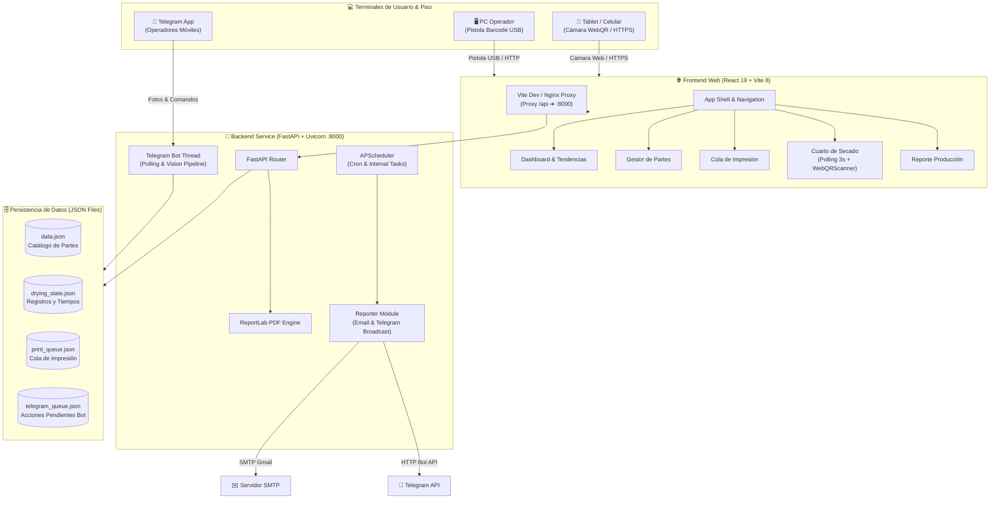

# 🏭 Sistema de Gestión de Etiquetas y Control de Cuarto de Secado

[](https://react.dev/)
[](https://vitejs.dev/)
[](https://tailwindcss.com/)
[](https://fastapi.tiangolo.com/)
[](https://python.org/)
[](https://telegram.org/)

Una plataforma industrial integral diseñada para optimizar y auditar el ciclo de vida de producción en piso de manufactura: administración centralizada de números de parte, generación masiva de etiquetas PDF industriales de 6×5 pulgadas con doble código QR, control de tiempos en cuarto de secado bajo metodología FIFO con detección de anomalías en tiempo real, escáner móvil y físico integrado, bot de Telegram con visión artificial (PyZbar + OpenCV + Tesseract OCR) y reportes automatizados vía Telegram y correo electrónico con libros Excel adjuntos.

---

## 📑 Tabla de Contenidos

1. [Características Principales](#-características-principales)
2. [Módulos del Sistema](#-módulos-del-sistema)
   - [Dashboard & Tendencias](#1-dashboard-principal--tendencia-de-producción)
   - [Gestor de Números de Parte](#2-gestor-de-números-de-parte)
   - [Cola de Impresión de Etiquetas](#3-cola-de-impresión-de-etiquetas)
   - [Control del Cuarto de Secado](#4-control-del-cuarto-de-secado)
   - [Reporte de Producción](#5-reporte-de-producción)
3. [Tecnologías y Librerías](#-stack-tecnológico)
4. [Arquitectura del Sistema](#-arquitectura-del-sistema)
5. [Estructura del Proyecto](#-estructura-del-proyecto)
6. [Instalación y Puesta en Marcha](#-instalación-y-ejecución)
   - [Inicio Rápido (Windows)](#inicio-rápido-en-windows)
   - [Arranque Manual (Desarrollo)](#arranque-manual)
7. [Variables de Entorno (.env)](#-variables-de-entorno-backend-env)
8. [Especificación de la API REST](#-especificación-de-la-api-rest)
9. [Bot de Telegram y Visión Artificial](#-bot-de-telegram-y-visión-artificial)
10. [Reportes Automatizados Programados](#-reportes-automatizados-reporterpy)
11. [Robusto Sistema de Escaneo QR y Código de Barras](#-sistema-robusto-de-escaneo-qr)
12. [Guía de Despliegue en Servidores AWS (Ubuntu)](#-despliegue-en-producción-aws-ec2)
13. [Documentación Adicional](#-documentación-adicional)

---

## 🚀 Características Principales

- **Gestión de Catálogo Maestro:** Alta, baja, edición e importación masiva de partes desde hojas de cálculo Excel (`.xlsx`) y archivos `.csv`.
- **Motor de Impresión PDF Industrial:** Formato optimizado de 4 etiquetas por página en hoja carta apaisada (*landscape*), etiquetas de 6×5 pulgadas con especificaciones EPP, metadatos de lote, turno, cliente y 2 códigos QR vectoriales con ReportLab.
- **Trazabilidad en Cuarto de Secado (FIFO):** Entrada y salida por escáner de códigos, timers independientes en vivo, semáforos de tolerancia, detección de salidas anticipadas y advertencias de carritos vencidos.
- **Doble Modalidad de Escaneo:**
  - 📷 **Cámara Web / Dispositivo Móvil:** Escaneo nativo con `html5-qrcode` y HTTPS local mediante `@vitejs/plugin-basic-ssl`.
  - 🔫 **Pistola de Códigos de Barras USB/Bluetooth:** Detección automática en segundo plano con normalización de caracteres para teclados en español/inglés.
- **Bot Asistente de Telegram con OCR:** Lectura inteligente de etiquetas por foto usando pirámide de resolución (PyZbar ➔ OpenCV Ecualizado ➔ OpenCV QR Detector ➔ Tesseract OCR + corrección de patrones difusos `difflib`).
- **Analítica Visual Nativa:** Gráfica lineal interactiva y de barras SVG responsiva (sin librerías pesadas externas), modal de detalle analítico de los modelos principales y métricas de dispersión estadística.
- **Reportes Programados en Segundo Plano:** Generación periódica mediante `APScheduler` de resúmenes por hora en Telegram y correos de cierre de turno (07:30 AM y 07:30 PM) con tablas HTML y archivos `.xlsx` adjuntos generados con `pandas` y `openpyxl`.

---

## 📦 Módulos del Sistema

### 1. Dashboard Principal & Tendencia de Producción
- Monitoreo del estado de conexión del backend en tiempo real (indicador online/offline con pulso visual, revalidación cada 30 segundos).
- Tarjetas de acceso directo e intuitivo a cada uno de los 4 módulos operativos.
- **Gráfica Interactiva de Tendencia por Número de Parte:**
  - Visualización del volumen de piezas ingresadas al secador agrupadas por número de parte.
  - Filtro interactivo de temporalidad: **Hoy**, **Últimos 7 días** o **Últimos 30 días**.
  - Filtro por turno de operación: **Todos**, **Turno Día** (07:30 - 19:30) o **Turno Noche** (19:30 - 07:30).
  - Modal ampliado con gráfica SVG multi-línea con tooltips flotantes para los 5 números de parte con mayor volumen.
  - KPIs consolidados: Total de piezas producidas, lotes procesados y ranking porcentual.

### 2. Gestor de Números de Parte
- Catálogo maestro de números de parte con búsqueda instantánea por texto o código.
- Formulario de captura y edición reactivo:
  - `Número de Parte` (identificador clave).
  - `Descripción` operativa de la pieza.
  - `Línea` / Máquina asociada.
  - `ID` interno de control.
  - `Cantidad por Etiqueta (QTU)` (piezas por carrito/caja).
  - `Cliente (LG)` o línea de destino.
  - `Ayuda Visual` (enlace o referencia técnica).
- Importación masiva desde archivos `.xlsx` y `.csv` con validación de cabeceras, límites de tamaño (5 MB) y sanitización de datos.
- Modales de confirmación interactivos (`useConfirm`) para borrado seguro de piezas.

### 3. Cola de Impresión de Etiquetas
- Formulario para configurar tandas de impresión por número de parte, cantidad de etiquetas y asignación de turno.
- Tabla de cola de impresión con persistencia en backend (`print_queue.json`).
- Generación de PDF industrial mediante **ReportLab**:
  - Cuadrícula de 4 etiquetas por hoja tamaño carta horizontal.
  - Dimensiones de 6×5 pulgadas escaladas con márgenes exactos.
  - Logotipo institucional (`Logo.png`), fecha de emisión, turno, ID, QTU, línea, EPP y pie de página IQC.
  - **Doble código QR:** QR primario con ficha técnica multilínea y QR secundario simplificado.
- Descarga directa o apertura automática en nueva pestaña del navegador.
- Botón de vaciado de cola con confirmación visual.

### 4. Control del Cuarto de Secado
- Registro ágil de entradas y salidas de carritos mediante código de barras o código QR.
- **Políticas de Tiempo y Alertas Automáticas:**
  - 🔴 **Tiempo Vencido:** Umbral configurable en minutos (guardado en `localStorage`). Si un carrito supera el límite, su tarjeta y KPI pulsan en rojo con el distintivo `🔴 VENCIDO`.
  - 🟡 **Salida Anticipada:** Si un carrito es retirado con 10 o más minutos de anticipación respecto al promedio histórico registrado para esa pieza, se emite una notificación de advertencia preventiva y se etiqueta el registro con `earlyExit: true`.
  - ⚠️ **Control de Rezago:** Carritos que cruzan la frontera de cambio de turno reciben la etiqueta `⚠️ REZAGO`.
- **Panel de Análisis Estadístico:**
  - Métricas de tiempo de secado por número de parte: Mínimo, Máximo, Promedio y Desviación Estándar.
  - Semáforo de estabilidad del proceso: 🟢 Estable (<5 min desv.), 🟡 Variable (5–15 min), 🔴 Inestable (>15 min).
  - Conteo de incidencias por salida anticipada.
- **Sincronización Multidispositivo:** Polling automático cada 3 segundos que detecta modificaciones realizadas desde otras terminales, dispositivos móviles o el bot de Telegram.
- **Depuración y Retención de Datos:** Poda automática de registros de más de 30 días para evitar degradación de memoria.

### 5. Reporte de Producción
- Visualización tabular de todos los lotes ingresados al proceso de secado.
- Filtros rápidos por calendario (selector de fecha) y por turno operativo (Día / Noche / Todos).
- Sumatoria instantánea de piezas y lotes completados.
- Exportación directa de la vista filtrada en formato `.csv` descargable para auditorías o análisis en Excel.

---

## 🛠️ Stack Tecnológico

### Frontend
| Tecnología | Versión | Rol / Propósito |
|---|---|---|
| **React** | `^19.2` | Biblioteca de interfaz de usuario con hooks y contextos personalizados |
| **Vite** | `^8.0` | Entorno de desarrollo ultrarrápido y empaquetador ESM |
| **Tailwind CSS** | `^4.3` | Sistema de diseño utilitario contemporáneo con soporte de gradientes y animaciones |
| **html5-qrcode** | `^2.3` | Motor de captura y decodificación de video en navegadores cliente |
| **@vitejs/plugin-basic-ssl** | `^2.3` | Generación de certificados SSL locales (HTTPS) requeridos para acceder a la cámara |
| **Custom Hooks** | — | `useToast` (notificaciones flotantes) y `useConfirm` (modales de confirmación) |

### Backend
| Paquete / Módulo | Rol / Propósito |
|---|---|
| **FastAPI** | Framework asíncrono de alto rendimiento para la API REST |
| **Uvicorn** | Servidor ASGI para producción y desarrollo local |
| **Pydantic** | Validación estricta y coercitiva de modelos de datos |
| **ReportLab** | Generación de documentos PDF con gráficos vectoriales y códigos QR |
| **Pandas & OpenPyXL** | Manipulación de estructuras tabulares, lectura y exportación a Excel `.xlsx` |
| **APScheduler** | Planificador en segundo plano para tareas cron y periódicas |
| **pyTelegramBotAPI** | Cliente para bot interactivo de Telegram con soporte multimedia |
| **PyZbar** | Decodificación nativa de códigos QR y códigos de barras 1D/2D |
| **OpenCV (Headless)** | Preprocesamiento de imágenes (ecualización, escala de grises, filtrado de ruido) |
| **Pillow (PIL)** | Manipulación y transformación de imágenes en memoria |
| **Pytesseract** | Motor de reconocimiento óptico de caracteres (OCR) como respaldo |
| **python-dotenv** | Administración de variables de entorno seguras |

---

## 🗂️ Arquitectura del Sistema



---

## 📁 Estructura del Proyecto

```
CSECADO/
├── package.json                    # Configuración raíz de soporte
└── mi-sistema-etiquetas/
    ├── backend/
    │   ├── main.py                 # API REST FastAPI, endpoints y ciclo de vida
    │   ├── telegram_bot.py         # Bot de Telegram, pipeline de visión y OCR
    │   ├── reporter.py             # Generador de reportes Excel y despachador de emails
    │   ├── Logo.png                # Imagen institucional para las etiquetas
    │   ├── data.json               # Almacén de catálogo de partes (auto-generado)
    │   ├── drying_state.json       # Estado y registros del cuarto de secado
    │   ├── print_queue.json        # Cola de etiquetas pendientes de impresión
    │   ├── telegram_queue.json     # Cola de notificaciones generadas por Telegram
    │   ├── requirements.txt        # Dependencias de Python
    │   └── .env                    # Credenciales y secretos (excluido en .gitignore)
    ├── src/
    │   ├── components/
    │   │   ├── MainMenu.jsx        # Dashboard principal con gráfica lineal de tendencia
    │   │   ├── PartManager.jsx     # Catálogo de partes y subida de Excel/CSV
    │   │   ├── PrintQueue.jsx      # Administración de cola de impresión
    │   │   ├── DryingRoom.jsx      # Monitoreo del cuarto de secado y FIFO
    │   │   ├── ProductionReport.jsx# Filtros y sumatoria de producción
    │   │   └── WebQRScanner.jsx    # Modal de escaneo por cámara (html5-qrcode)
    │   ├── hooks/
    │   │   ├── useToast.jsx        # Sistema de alertas toast con animaciones
    │   │   └── useConfirm.jsx      # Modal de confirmación estilizado
    │   ├── api.js                  # Función envoltorio centralizada para llamadas a la API
    │   ├── App.jsx                 # Componente raíz y navegación responsiva
    │   ├── main.jsx                # Montaje de React DOM
    │   └── index.css               # Estilos globales de Tailwind CSS
    ├── public/                     # Recursos públicos estáticos
    ├── docs/                       # Documentación técnica extendida
    │   ├── ARQUITECTURA.md         # Detalle de arquitectura, hilos y persistencia
    │   ├── API_ENDPOINTS.md        # Documentación de endpoints y contratos JSON
    │   ├── BOT_TELEGRAM.md         # Guía completa de uso y visión artificial del bot
    │   ├── MANUAL_USUARIO.md       # Manual operativo de usuario para planta
    │   └── DESPLIEGUE_AWS.md       # Guía paso a paso para despliegue en AWS EC2
    ├── start.bat                   # Script de inicio en 1 clic para Windows
    ├── vite.config.js              # Configuración de Vite con SSL y proxy reverso
    ├── package.json                # Dependencias de frontend (Node.js)
    └── README.md                   # Documentación principal del repositorio
```

---

## ⚙️ Instalación y Ejecución

### Prerrequisitos
- **Python 3.9 o superior** — [Descargar Python](https://www.python.org/downloads/)
- **Node.js 18 o superior** — [Descargar Node.js](https://nodejs.org/)
- *(Opcional para OCR en Windows)* **Tesseract-OCR** instalado en `C:\Program Files\Tesseract-OCR\tesseract.exe`.

---

### Inicio Rápido en Windows
Haz doble clic en el archivo `start.bat` ubicado en `mi-sistema-etiquetas/start.bat`. El script verificará los entornos, levantará el backend en el puerto `8000`, el frontend en el puerto `5173` y abrirá tu navegador predeterminado automáticamente.

---

### Arranque Manual

#### 1. Configuración del Backend
```bash
cd mi-sistema-etiquetas/backend

# Crear y activar entorno virtual (recomendado)
python -m venv venv
# En Windows:
venv\Scripts\activate
# En Linux/macOS:
source venv/bin/activate

# Instalar librerías de Python
pip install -r requirements.txt

# Iniciar servidor FastAPI
uvicorn main:app --reload --host 0.0.0.0 --port 8000
```
- 🌐 API activa en: `http://localhost:8000`
- 📑 Documentación Swagger interactiva: `http://localhost:8000/docs`

#### 2. Configuración del Frontend
```bash
cd mi-sistema-etiquetas

# Instalar paquetes de npm
npm install

# Iniciar servidor de desarrollo Vite con SSL local
npm run dev
```
- 🖥️ Aplicación web disponible en: `https://localhost:5173` (o `http://localhost:5173`)

---

## 🔧 Variables de Entorno (Backend `.env`)

Crea o edita el archivo `mi-sistema-etiquetas/backend/.env` con la siguiente estructura:

```env
# Configuración del Bot de Telegram
TELEGRAM_BOT_TOKEN="123456789:ABCDEF_tu_token_aqui"
TELEGRAM_CHAT_ID="7629357744, -1004412654974"

# Servidor de Correo para Reportes Automáticos (Gmail u otro)
SMTP_SERVER="smtp.gmail.com"
SMTP_PORT=587
EMAIL_SENDER="notificaciones@tuempresa.com"
EMAIL_PASSWORD="xxxx xxxx xxxx xxxx"
EMAIL_RECEIVERS="gerente@empresa.com, supervisor@empresa.com"
```

> [!TIP]
> Si utilizas Gmail para `EMAIL_SENDER`, genera una **Contraseña de Aplicación** desde tu cuenta de Google (Seguridad ➔ Verificación en 2 pasos ➔ Contraseñas de aplicación).

Para el frontend, si deseas apuntar a un servidor remoto específico en vez de utilizar el proxy por defecto `/api`, puedes crear un archivo `.env` en la raíz de `mi-sistema-etiquetas`:
```env
VITE_API_URL=https://tu-servidor-en-produccion.com:8000
```

---

## 📡 Especificación de la API REST

| Método | Endpoint | Descripción | Payload / Parámetros |
|---|---|---|---|
| `GET` | `/parts` | Obtiene el catálogo completo de partes | Ninguno |
| `POST` | `/parts/{part_number}` | Registra un nuevo número de parte | JSON (`PartData`) |
| `PUT` | `/parts/{old_part_number}` | Actualiza datos de una parte (y su clave si cambió) | JSON (`PartData`), query `new_part_number` |
| `DELETE` | `/parts/{part_number}` | Elimina una parte del catálogo | Ninguno |
| `POST` | `/parts/import` | Carga masiva mediante archivo Excel o CSV | `multipart/form-data` con archivo |
| `GET` | `/print-queue/state` | Obtiene la lista actual de etiquetas en cola | Ninguno |
| `POST` | `/print-queue/state` | Guarda el estado de la cola de impresión | JSON (`PrintQueueState`) |
| `POST` | `/print-queue/generate-pdf`| Genera y descarga el PDF con etiquetas e IDs únicos | JSON (`List[PrintQueueItem]`) ➔ Archivo PDF |
| `GET` | `/labels/{label_id}` | Obtiene los datos de una etiqueta por su ID único | Ninguno |
| `GET` | `/drying-room/state` | Retorna carritos activos, acumulados y turnos | Ninguno |
| `POST` | `/drying-room/state` | Sincroniza el estado del secador y purga >30 días | JSON (`DryingState`) |
| `POST` | `/drying-room/scan` | Registra entrada o salida directa vía escáner web/móvil | JSON (`qr_data`, `action: "entrada"\|"salida"`) |
| `GET` | `/telegram-queue` | Obtiene eventos pendientes generados por el bot | Ninguno |
| `POST` | `/telegram-queue/clear` | Actualiza o vacía eventos pendientes del bot | JSON (`actions: List[Dict]`) |

> 📚 Para ver esquemas de datos completos y ejemplos de peticiones cURL, consulta [`docs/API_ENDPOINTS.md`](docs/API_ENDPOINTS.md).

---

## 🤖 Bot de Telegram y Visión Artificial

El bot (`telegram_bot.py`) se ejecuta concurrentemente como un hilo desacoplado dentro del ciclo de vida de FastAPI y permite el control total de operaciones de secado desde cualquier smartphone.

```
                    ┌─────────────────────────┐
                    │  Foto enviada al Bot    │
                    └────────────┬────────────┘
                                 │
                     ¿Decodifica con PyZbar?
                     ┌───────────┴───────────┐
                    SÍ                       NO
                     │                       │
           Extrae número de parte     ¿PyZbar en escala
                     │                gris ecualizada?
                     │                ┌──────┴──────┐
                     │               SÍ             NO
                     │                │             │
                     │         Extrae parte   ¿OpenCV QR Detector?
                     │                │       ┌─────┴─────┐
                     │                │      SÍ           NO
                     │                │       │           │
                     │                │       │    Tesseract OCR
                     │                │       │    + Corrección regex
                     │                │       │    + difflib Fuzzy Match
                     │                │       │           │
                     └────────────────┼───────┴───────────┘
                                      ▼
                        Identifica Número de Parte
                                      │
                   ┌──────────────────┴──────────────────┐
                   │                                     │
           Acción inmediata                      Acción pendiente
         (caption "entrada"                     (espera respuesta
          o caption "salida")                    "entrada" o "salida")
```

### Comandos de Texto Disponibles
- `entrada <NUM_PARTE>` — Registra la entrada manual de un carrito.
- `salida <NUM_PARTE>` — Concluye el ciclo de secado del carrito más antiguo de ese modelo.
- `reporte de producción` — Genera al instante el reporte de producción del turno actual y lo envía con el archivo Excel adjunto.
- `piezas de <NUM_PARTE>` — Consulta el volumen y lotes acumulados de esa pieza en el turno vigente.
- `cuarto de secado` — Lista en tiempo real todos los carritos en proceso de secado.

> 📖 Conoce detalles de configuración de grupos y fallbacks en [`docs/BOT_TELEGRAM.md`](docs/BOT_TELEGRAM.md).

---

## ⏰ Reportes Automatizados (`reporter.py`)

1. **Monitoreo por Hora (Telegram):**
   - Ejecutado cada 60 minutos mediante `interval` en `APScheduler`.
   - Envía a todos los `TELEGRAM_CHAT_ID` el conteo de lotes y piezas acumuladas del turno en curso, acompañado de su respectivo libro `.xlsx`.
2. **Cierre Oficial de Turno (Email + Telegram):**
   - Ejecutado a las **07:30 AM** (cierre de turno noche) y a las **19:30 PM** (cierre de turno día).
   - Envía correo con formato HTML ejecutivo y tabla detallada por modelo a los destinatarios configurados en `EMAIL_RECEIVERS`, con el libro Excel adjunto generado con `openpyxl`.
   - Simultáneamente publica el cierre formal en el grupo de Telegram.

---

## 🛡️ Sistema Robusto de Escaneo QR

El sistema implementa defensas para evitar lecturas erróneas comunes en ambientes de producción:

1. **Validación Estricta de Fecha:**
   - Al escanear una etiqueta completa multilínea en la entrada, se compara la fecha impresa con la fecha actual del sistema. Si la etiqueta es de días anteriores, se bloquea la operación para evitar reingresos accidentales.
2. **Corrección de Mapeo de Teclado (Pistolas USB):**
   - Pistolas configuradas en distribución inglesa en computadoras con Windows en español sustituyen caracteres (por ejemplo `Ñ` en vez de `:` y `-` en vez de `/`). El parser regex normaliza estos errores de forma transparente.
3. **Soporte de Cámara Web Local y Móvil:**
   - La integración con `html5-qrcode` en [WebQRScanner.jsx](file:///d:/p/CSECADO/mi-sistema-etiquetas/src/components/WebQRScanner.jsx) forza la cámara trasera (`environment`) en celulares y opera sobre conexiones seguras generadas por Vite SSL.

---

## ☁️ Despliegue en Producción (AWS EC2)

Para desplegar en una instancia Ubuntu Linux en Amazon Web Services (AWS):

```bash
# 1. Actualizar repositorios e instalar librerías de sistema
sudo apt update && sudo apt install -y python3-pip python3-venv libzbar0 libgl1 tesseract-ocr nginx

# 2. Clonar y preparar entorno
cd ~/
git clone <URL_REPOSITORIO>
cd CSECADO/mi-sistema-etiquetas/backend

# 3. Instalar requerimientos (versión headless recomendada para servidores)
pip install -r requirements.txt --break-system-packages

# 4. Configurar variables de entorno de producción
nano .env

# 5. Iniciar servicio con Uvicorn en background o mediante systemd
python3 -m uvicorn main:app --host 0.0.0.0 --port 8000 &
```

> 📖 Consulta la guía integral de configuración con servicio `systemd`, proxy `Nginx` y certificados SSL en [`docs/DESPLIEGUE_AWS.md`](docs/DESPLIEGUE_AWS.md).

---

## 📚 Documentación Adicional

Para profundizar en el desarrollo, administración y uso del sistema, consulta los siguientes manuales:

- [📐 Arquitectura Técnica del Sistema](docs/ARQUITECTURA.md) — Flujos de datos, persistencia concurrente y modelos.
- [🔌 Referencia Completa de la API REST](docs/API_ENDPOINTS.md) — Contratos JSON, códigos HTTP y ejemplos cURL.
- [🤖 Manual del Bot de Telegram & Visión](docs/BOT_TELEGRAM.md) — Pipeline de OCR, comandos y administración.
- [📖 Manual de Operación para Planta](docs/MANUAL_USUARIO.md) — Guía ilustrada para operadores y supervisores.
- [🚀 Despliegue en Servidores AWS EC2](docs/DESPLIEGUE_AWS.md) — Configuración de systemd, Nginx y variables seguras.

---

<div align="center">
  <sub>Desarrollado para la optimización industrial y control de calidad en manufactura.</sub>
</div>
