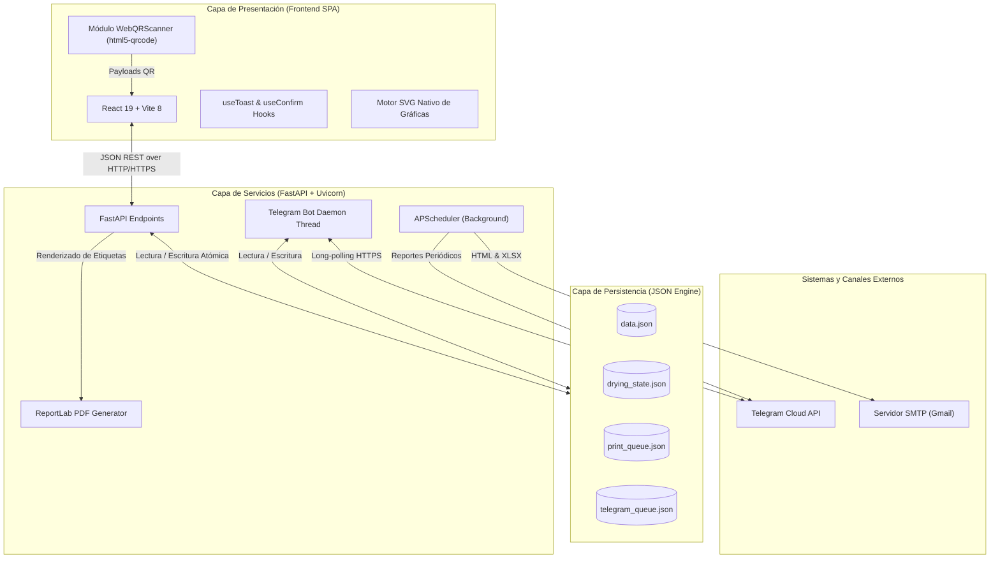
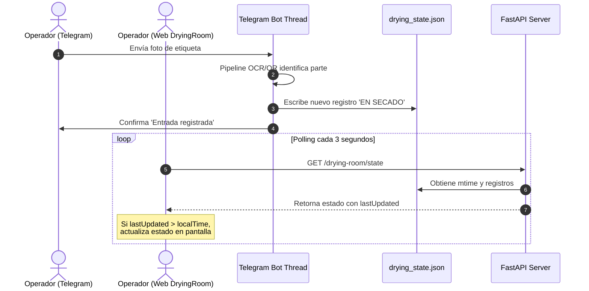

# 📐 Arquitectura Técnica del Sistema

Este documento describe la arquitectura global, los flujos de sincronización de datos, los modelos de persistencia, los ciclos de vida de hilos y las decisiones de diseño del **Sistema de Gestión de Etiquetas y Cuarto de Secado**.

---

## 1. Visión General de la Arquitectura

El sistema se compone de dos capas principales (Frontend y Backend) intercomunicadas por HTTP/REST y complementadas con un servicio de bot interactivo de Telegram y un planificador de tareas cron en segundo plano (`APScheduler`):



---

## 2. Capa Frontend (React 19 + Vite 8)

### 2.1 Componentes y Navegación
La navegación principal no requiere recarga completa de página y está orquestada por el componente raíz [App.jsx](file:///d:/p/CSECADO/mi-sistema-etiquetas/src/App.jsx):
- **[MainMenu.jsx](file:///d:/p/CSECADO/mi-sistema-etiquetas/src/components/MainMenu.jsx):** Dashboard principal que consume `/parts` para diagnosticar el estado del servidor cada 30 segundos y `/drying-room/state` para generar la gráfica de tendencia de volumen por número de parte.
- **[PartManager.jsx](file:///d:/p/CSECADO/mi-sistema-etiquetas/src/components/PartManager.jsx):** Módulo de administración de piezas, soporte para búsqueda reactiva y carga de hojas de cálculo con `FormData`.
- **[PrintQueue.jsx](file:///d:/p/CSECADO/mi-sistema-etiquetas/src/components/PrintQueue.jsx):** Cola interactiva de impresión con sincronización debounceada hacia `/print-queue/state` y generación binaria de PDF.
- **[DryingRoom.jsx](file:///d:/p/CSECADO/mi-sistema-etiquetas/src/components/DryingRoom.jsx):** Núcleo operativo del cuarto de secado con lógica FIFO, timers independientes cada 30s por carrito y polling de sincronización cada 3s.
- **[WebQRScanner.jsx](file:///d:/p/CSECADO/mi-sistema-etiquetas/src/components/WebQRScanner.jsx):** Componente modal que inicializa `Html5QrcodeScanner` en modo cámara trasera (`environment`).
- **[ProductionReport.jsx](file:///d:/p/CSECADO/mi-sistema-etiquetas/src/components/ProductionReport.jsx):** Vista consolidada de producción por fecha y turno con exportación a `.csv`.

### 2.2 Hooks del Sistema
- **[useToast.jsx](file:///d:/p/CSECADO/mi-sistema-etiquetas/src/hooks/useToast.jsx):** Provee una cola de notificaciones flotantes con animaciones Tailwind, auto-cierre con timeouts configurables y estilos semánticos (`success`, `error`, `warning`, `info`).
- **[useConfirm.jsx](file:///d:/p/CSECADO/mi-sistema-etiquetas/src/hooks/useConfirm.jsx):** Reemplazo no bloqueante para `window.confirm()`. Emite una promesa y dibuja un modal estilizado con opción de confirmación destructiva (`danger`).

---

## 3. Capa Backend (FastAPI + Python)

### 3.1 Ciclo de Vida (`lifespan`)
El ciclo de vida del backend está centralizado en el context manager `lifespan`:
1. **Hilo del Bot de Telegram:** Se inicia como demonio (`threading.Thread(target=start_bot, daemon=True)`) ejecutando `bot.infinity_polling()`.
2. **Programador de Tareas (APScheduler):**
   - Intervalo horario: Envía reporte de producción a Telegram cada hora (`hours=1`).
   - Tareas Cron: Envía correos con reportes consolidados y adjuntos Excel a las **07:30 AM** y a las **19:30 PM**.
3. **Shutdown seguro:** Al detener el proceso Uvicorn, el scheduler se apaga de forma limpia (`scheduler.shutdown()`).

### 3.2 Persistencia de Estado
Para mantener una arquitectura ligera, sin dependencias pesadas de bases de datos relacionales, el sistema almacena su estado en archivos JSON estructurados con codificación UTF-8:

| Archivo | Contenido | Frecuencia de Actualización |
|---|---|---|
| `data.json` | Diccionario indexado por número de parte (`{ PART: { descripcion, linea, ... } }`) | Bajo demanda (CRUD o importación) |
| `drying_state.json` | Lista de registros (`records`), acumulados por parte y conteo de carritos | En cada escaneo, salida o cambio de turno |
| `print_queue.json` | Lista de solicitudes de impresión pendientes | Debounce de 800 ms al alterar la cola |
| `telegram_queue.json` | Eventos originados por el bot para alertar al frontend | En cada escaneo exitoso desde Telegram |

---

## 4. Estrategia de Sincronización en Tiempo Real

Para permitir que múltiples operadores en distintas computadoras, tablets con escáner web y teléfonos con Telegram compartan la misma información sin colisiones:



---

## 5. Algoritmo de Turnos y Poda de Datos (Data Pruning)

### Regla de Turnos
- **Turno DÍA:** De 07:30:00 a 19:29:59 horas.
- **Turno NOCHE:** De 19:30:00 a 07:29:59 horas (abarca el cambio de medianoche).

### Poda Automática a 30 Días
Al ejecutarse `POST /drying-room/state`, el backend filtra automáticamente los registros históricos:
```python
cutoff = (datetime.now() - timedelta(days=30)).isoformat()
filtered_records = [
    r for r in state.records
    if not r.get('horaEntrada') or r.get('horaEntrada', '') >= cutoff or r.get('estado') == 'EN SECADO'
]
```
> Los carritos activos (`estado == 'EN SECADO'`) nunca son podados, garantizando que carritos en proceso no se pierdan.
